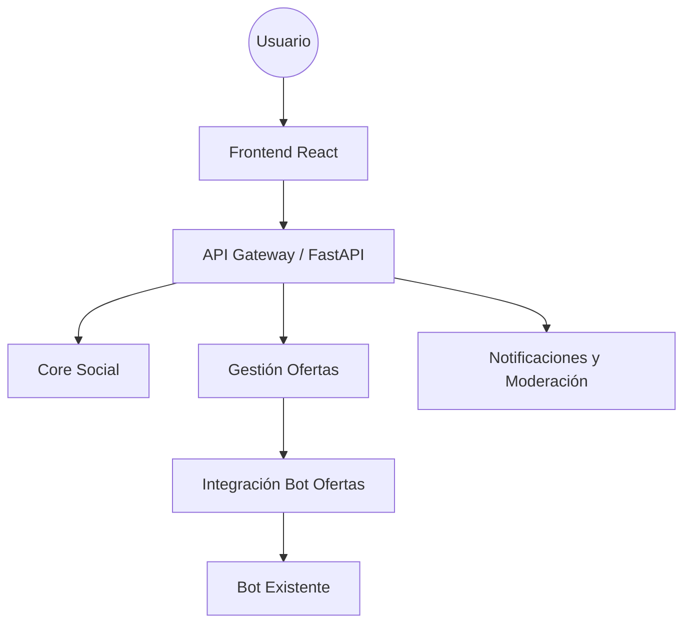

<!-- architecture v1.0 aprobado 2026-11-02T19:25:39+00:00 · artefacto art_2fe2a05efd42 · sha ed628e9b169f -->
# Architecture Package — Plataforma web de ofertas de alimentos para estudiantes universitarios de Manizales

## 1. Architecture Drivers
| Driver | Prioridad | Evidencia en la SPEC |
| :--- | :--- | :--- |
| Disponibilidad y Aislamiento de Fallos | Alta | RNF-006, RF-017, HU-18 |
| Integración con Componente Existente (Bot) | Alta | RES-01, HEC-02 |
| Experiencia de Usuario Mobile-First | Media | RNF-008, HU-33 |

## 2. Restricciones
- Uso de componente existente (Bot Ofertas) como fuente de datos.
- Perfil de ejecución: `python-fastapi-react-vite`.
- Seguridad: HTTPS obligatorio y autenticación mediante JWT.
- Despliegue: Servicio en la nube estándar (PaaS).

## 3. Atributos de Calidad Relevantes
- **Disponibilidad:** El sistema debe mantener la operatividad del bot de scraping ante fallos parciales.
- **Usabilidad:** Interfaz optimizada para dispositivos móviles (Mobile-First).
- **Mantenibilidad:** Estructura de monolito modular para facilitar la evolución de componentes.

## 4. Alternativas Consideradas
### Microservicios
Arquitectura distribuida con servicios independientes. Descartada por complejidad operativa innecesaria para el alcance inicial del proyecto.
### Monolito Modular
Estructura unificada con límites de dominio claros. Seleccionada por equilibrar simplicidad de despliegue con aislamiento lógico de componentes.
### Arquitectura Hexagonal
Enfoque centrado en el dominio. Se considera una sobreingeniería para el tamaño actual del equipo y los requisitos definidos.

## 5. Matriz de Decisión
| Criterio | Monolito Modular | Microservicios | Hexagonal |
| :--- | :--- | :--- | :--- |
| Simplicidad de Despliegue | Alta | Baja | Media |
| Aislamiento de Lógica | Alta | Muy Alta | Alta |
| Esfuerzo de Desarrollo | Bajo | Alto | Medio |
| **Selección** | **Ganador** | - | - |

## 6. Arquitectura Seleccionada
Monolito Modular con enfoque API-First. Permite separar la lógica de negocio (Social, Ofertas, Notificaciones) mientras se mantiene un despliegue unificado.

## 7. Diagrama Conceptual

## 8. Componentes y Responsabilidades
- **CMP-01 Core Social:** Gestión de usuarios, perfiles, seguimiento y feed social.
- **CMP-02 Gestión de Ofertas:** Publicación, edición, eliminación y calificación de ofertas comunitarias.
- **CMP-03 Integración Bot Ofertas:** Orquestación del componente bot_ofertas, scraping y mapa.
- **CMP-04 Notificaciones y Moderación:** Alertas Telegram, reportes, panel de administración y gestión operativa.

## 9. Integraciones
- **INT-01 Bot Ofertas:** Componente existente (tipo: existente). Requiere credenciales para scraping y acceso a Telegram Bot API.

## 10. Architecture Decision Record (ADR)
**ID:** ADR-001
**Título:** Selección de Framework Frontend: React con Vite
**Estado:** Propuesta
**Contexto:** Necesidad de una interfaz web responsive, mobile-first y altamente interactiva.
**Problema:** ¿Qué framework utilizar para el frontend?
**Alternativas:** HTML/CSS/JS puro, Vue.js, React con Vite.
**Decisión:** React con Vite.
**Justificación:** React ofrece un ecosistema robusto para interfaces dinámicas, Vite proporciona tiempos de carga rápidos (RNF-001) y el equipo tiene alta disponibilidad de perfiles de ejecución compatibles.
**Consecuencias positivas:** Alta productividad, excelente soporte para componentes reutilizables, rápido desarrollo.
**Consecuencias negativas:** Curva de aprendizaje inicial.
**Supuestos:** El equipo conoce React.
**Evidencia:** RNF-008, HU-33.

## 11. Decisiones de Diseño
- Uso de Pydantic para validación de esquemas en backend.
- Uso de Zod para validación de formularios en frontend.
- Implementación de JWT con expiración de 30 minutos.

## 12. Patrones de Diseño Potenciales
- **Repository Pattern:** Para abstraer el acceso a datos en `backend/app/db`.
- **Service Layer:** Para centralizar la lógica de negocio en `backend/app/services`.

## 13. Riesgos Técnicos
- Bloqueo de scraping por parte de los sitios web de supermercados.
- Límites de tasa (rate limiting) impuestos por la API de Telegram.

## 14. Supuestos
- El componente bot_ofertas es compatible con Python 3.10+.
- El entorno de despliegue soporta la ejecución de procesos en segundo plano para el bot.

## 15. Preguntas Técnicas Abiertas
- **Q-001:** ¿Cuál es la fórmula exacta para el cálculo de relevancia de las ofertas? (Negocio)

## 16. Trazabilidad
- **RF-001:** Driver Identidad -> ADR-001 -> CMP-01.

## 17. Resumen para el Equipo
Se presenta la arquitectura de Monolito Modular. Se solicita al equipo la validación del ADR-001 y la resolución de la pregunta abierta Q-001 sobre la lógica de relevancia. ¿Se aprueba el enfoque propuesto?

---

# Anexo — Contrato técnico para implementación

_Generado a partir de la salida estructurada del agente. Planning, Coding y QA usan este contrato._

**Estilo seleccionado:** Monolito Modular con API-First

**Perfil de ejecución:** `python-fastapi-react-vite` — Soporta el stack elegido (FastAPI + React) y permite ejecución de pruebas.

| Capa | Tecnología propuesta |
|---|---|
| Backend | Python, FastAPI, SQLAlchemy, SQLite |
| Frontend | React, Vite, TypeScript |
| Persistencia | SQLite |
| Pruebas | pytest, vitest |
| Otros | Telegram Bot API |

## Estructura del producto
| Raíz | Ruta |
|---|---|
| backend | backend |
| frontend | frontend |
| pruebas | backend/tests |

| Ruta | Propósito | Componente |
|---|---|---|
| backend/app/social | Gestión de usuarios y relaciones | CMP-01 |
| backend/app/ofertas | Gestión de ofertas comunitarias | CMP-02 |
| backend/bot | Componente existente bot_ofertas | CMP-03 |

## Contrato de API
_Sin elementos._

## Modelo de datos
## Integraciones
| ID | Nombre | Tipo | Componente | Estado | Descripción |
|---|---|---|---|---|---|
| INT-01 | Bot Ofertas | existente | CMP-03 | requiere_credenciales | Scraping de supermercados y notificaciones Telegram |

## Seguridad
- JWT para autenticación
- Hashing bcrypt
- HTTPS obligatorio

## Convenciones
- Rutas REST: /api/v1/<recurso>
- Validaciones: Pydantic en backend, Zod en frontend
- Errores: {error: string, code: string, details: object}
- Arquitectura base: los endpoints, pantallas, campos y validaciones de cada HU los define Coding al implementar la HU, siguiendo estas convenciones, y los registra en el contrato vivo.

## Despliegue
Servicio en la nube estándar (PaaS)

## Capas del backend
| Capa | Carpeta | Responsabilidad |
|---|---|---|
| Rutas | backend/app/api | Endpoints HTTP |
| Servicios | backend/app/services | Lógica de negocio |
| Repositorios | backend/app/db | Acceso a datos |

## Frontend
**Framework:** React — ADR-001

| Carpeta | Propósito |
|---|---|
| frontend/src/pages | Vistas de la aplicación |
| frontend/src/components | Componentes UI reutilizables |
| frontend/src/services | Llamadas a la API |

### Pantallas
_Sin elementos._

### Componentes
_Sin elementos._

### Validaciones de formularios
_Sin elementos._

### Estilos (tokens de diseño)
| Token | Valor | Uso |
|---|---|---|
| primary-blue | #0056b3 | Botones principales |

**Estado compartido:** Context API o Zustand

**Sesión:** JWT en localStorage con expiración de 30 min
